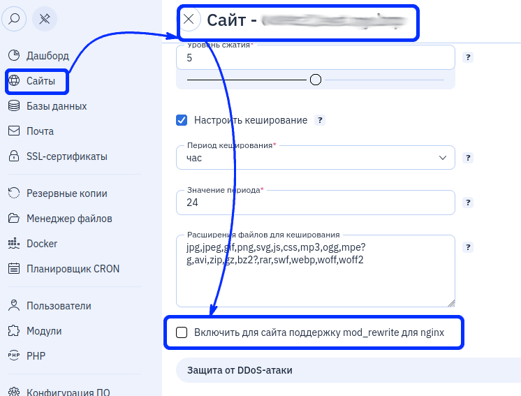

# ispmanager-mod_rewrite

## Description

Plugin for ispmanager to support [mod_rewrite](https://github.com/bayrepo/ngx_http_apache_rewrite_module)

## Supported OS

- AlmaLinux 9/10
- CentOS Stream 9/10
- and similar RedHat-based operating systems

## Working Description

During installation, the plugin attempts to detect the installed nginx and its version, downloads the required packages and source code of the nginx module, builds the module, and prepares the compiled .so file, placing it in the nginx modules directory.

Then in the ispmanager UI, the module can be activated and attached to desired sites.

The package includes a hook that monitors the nginx package version and rebuilds the module upon updates.

## Logs

Log files of the plugin and build process can be found at:

- /usr/local/mgr5/var/nginx-mod-rewrite-plugin-addon.log
- /usr/local/mgr5/var/nginx-mod-rewrite-plugin.log

## Package Build

Docker is required on the OS to build the package, and nothing else is needed.

To build the RPM package of the ispmanager plugin, run the following command:

```
bash build_package.sh almalinux:9
```

Where `almalinux:9` can be any RPM‑based OS image.

If the build succeeded, the `_packages` directory will contain rpm files, for example:

```
_packages/ispmanager-plugin-nginx_mod_rewrite_plugin-0.0.1-1.el9.src.rpm
_packages/ispmanager-plugin-nginx_mod_rewrite_plugin-0.0.1-1.el9.x86_64.rpm
```

This completes the build.

## Installation and Configuration

To install, you need to install the `ispmanager-plugin-nginx_mod_rewrite_plugin` package on a machine with ispmanager installed. ispmanager must be configured to support nginx.

During installation, some packages will be installed.

List of packages that will be installed:

- openssl-devel
- pcre-devel
- zlib-devel
- gcc
- gcc-c++
- make
- wget 
- python3

Because nginx requires building any module with the current version, the module is built during installation, detecting the nginx version and tailoring the build.

If nginx is updated, a hook is added during installation that rebuilds the module for the new version upon nginx update.

To install, you need to install the package built in the previous step:

```
sudo dnf install _packages/ispmanager-plugin-nginx_mod_rewrite_plugin-0.0.1-1.el9.x86_64.rpm
```

If the installation failed, the log can be examined here – `/usr/local/mgr5/var/nginx-mod-rewrite-plugin.log`.

If everything succeeded, go to the **Modules** section:


Find the **nginx mod_rewrite module** and click the settings icon. In the image above it is highlighted with a blue outline.

Then the module build window will open:


To cancel the build, click the **Cancel build** button. To build and install a hook for rebuilding upon nginx updates, click **Build module and install rebuild hook**.

The build process can be examined in the log: `/usr/local/mgr5/var/nginx-mod-rewrite-plugin.log`.

If the build succeeded, the following files will appear on the server:

```
# cat /usr/share/nginx/modules/ngx_http_apache_rewrite_module.conf 
load_module "/usr/lib64/nginx/modules/ngx_http_apache_rewrite_module.so";
```
and
```
/usr/lib64/nginx/modules/ngx_http_apache_rewrite_module.so
```
respectively.

If an out-of-plan rebuild of the module is needed, it can be launched manually with the command:

```
sudo /usr/local/ispmanager-mod_rewrite/utils/build_mod_rewrite.py
```

Next, go to the global module settings:


To do this, as shown in the image, go to **All sections** and then find the **mod_rewrite for nginx** section and its **Configure nginx module** menu item.

The following settings window will open:


Where:

- **Add nginx module** – the checkbox allows disabling the nginx module globally, i.e., the module load line in `/usr/share/nginx/modules/ngx_http_apache_rewrite_module.conf` is commented out. Be careful: if there is even one site using an option provided by the module, nginx will complain about unknown options and fail to start. Therefore, before disabling, disable mod_rewrite options on all sites.

- **Use template for site configuration** – the current plugin allows two ways to integrate into the site configuration:
		- **Option 1** – global enabling of mod_rewrite for the site (if the checkbox is not checked).
		- **Option 2** – enabling mod_rewrite for a location via the ispmanager template (if the checkbox is checked).
		- Each option will be described below.

- **Enable detailed logging** – if checked, detailed work of the ispmanager plugin is recorded in `/usr/local/mgr5/var/nginx-mod-rewrite-plugin-addon.log`. It may be needed if the plugin behaves incorrectly. In most cases this checkbox should be disabled.

Mod_rewrite can be enabled for a site via the **Sites** menu:



In the menu, select the site you are interested in, check the **Enable mod_rewrite support for nginx for the site** box, and save.

From this point on, the module will process `.htaccess` and mod_rewrite rules.

**Warning!** Please note that `<IfModule>` directives and directives unrelated to mod_rewrite are ignored.

**Option 1 – global enabling of mod_rewrite for the site (if the checkbox is not checked)**

In this option, a personalized configuration file is created for the user at `/etc/nginx/vhosts-resources/userX.domain/mod_rewrite.conf`:

```
# cat /etc/nginx/vhosts-resources/userX.domain/mod_rewrite.conf
GlobalLocationRewriteEngine on;
HtaccessEnable on;
```

It is included via standard ispmanager virtual host settings:

```
cat /etc/nginx/vhosts/userX/userX.domain.conf
server {
	server_name domain;
	charset off;
	...
	include /etc/nginx/vhosts-resources/userX.domain/*.conf;
	include /etc/nginx/users-resources/userX/*.conf;
	...
}
```

This file configures the virtual host to redirect all requests through mod_rewrite.

**Option 2 – enabling mod_rewrite for a location via the ispmanager template (if the checkbox is checked)**

In this option, ispmanager templating is used.

Using patches from `/usr/local/ispmanager-mod_rewrite/patches`, modified templates for the virtual host are created:

```
/usr/local/mgr5/etc/templates/nginx-vhosts-ssl.template
/usr/local/mgr5/etc/templates/nginx-vhosts.template
```

The control panel replaces the default templates with these, and when the **Enable mod_rewrite support for nginx for the site** checkbox is checked, the following configuration file is generated for the site:

```
# cat /etc/nginx/vhosts/userX/userX.domain.conf
server {
	server_name domain;
	...
	location / {
		...
		RewriteEngine on;
	}
	location @php {
			...
		RewriteEngine on;
	}
	...
	HtaccessEnable on;
}
```

This approach allows more precise handling of rules for different locations, and also excludes some of them.

**Additional recommendations**

When mod_rewrite for nginx is enabled, it is recommended to disable the site's **Enable friendly URL handling** option, as it takes over mod_rewrite functions.
