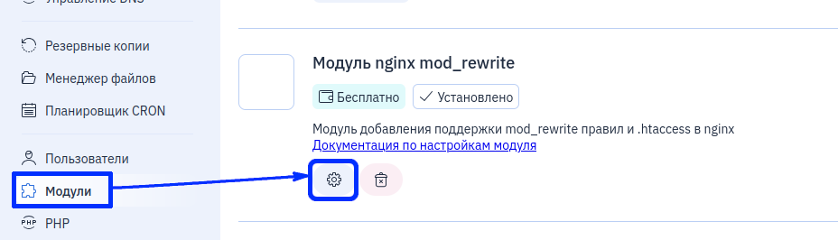
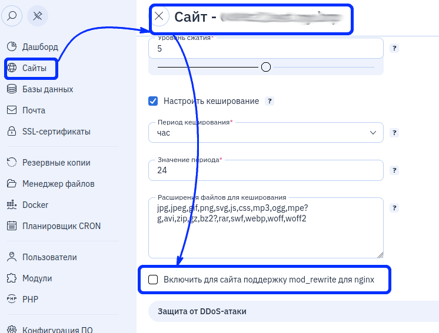

# ispmanager-mod_rewrite

## Описание

Плагин для ispmanager для поддержки [mod_rewrite](https://github.com/bayrepo/ngx_http_apache_rewrite_module)

## Поддерживаемые ОС

- AlmaLinux 9/10
- CentOS Stream 9/10
- и подобные операционные системы на базе RedHat

## Описание работы

Плагин при установке пытается определить установленный nginx и его версию, скачивает необходимые пакеты и исходные коды модуля для nginx, собирает модуль и подготавливает собранный .so файл, размещая его в каталоге модулей nginx.

Далее в UI ispmanager можно активировать модуль и подключить его для нужных сайтов.

В пакете установлен хук, который отслеживает версию пакета nginx и при обновлении пересобирает модуль.

## Логи

Файлы логов работы плагина и сборки можно найти по пути:

- /usr/local/mgr5/var/nginx-mod-rewrite-plugin-addon.log
- /usr/local/mgr5/var/nginx-mod-rewrite-plugin.log

## Сборка пакета

Для сборки пакета требуется наличие Docker в ОС, и больше ничего не нужно.
Для сборки пакета RPM плагина для ispmanager необходимо выполнить следующую команду:

```
bash build_package.sh almalinux:9
```

Где almalinux:9 – это может быть любой образ RPM‑based ОС.

Если сборка прошла успешно, в каталоге _packages появятся rpm‑файлы, пример таких файлов:

```
_packages/ispmanager-plugin-nginx_mod_rewrite_plugin-0.0.1-1.el9.src.rpm
_packages/ispmanager-plugin-nginx_mod_rewrite_plugin-0.0.1-1.el9.x86_64.rpm
```

На этом сборка окончена.

## Установка и описание настроек

Для установки необходимо установить пакет `ispmanager-plugin-nginx_mod_rewrite_plugin` на машине с установленным ispmanager. ispmanager должен быть сконфигурирован для поддержки nginx. Во время установки будут установлены некоторые пакеты.

Список пакетов, которые будут установлены:

- openssl-devel
- pcre-devel
- zlib-devel
- gcc
- gcc-c++
- make
- wget 
- python3

Т.к. nginx требует сборки любого модуля именно с текущей версией, модуль собирается при установке, определяя версию nginx и подстраивая сборку.

Если же nginx обновляется, при установке добавляется хук, который при обновлении nginx пересобирает модуль для новой версии.

Для установки нужно установить собранный в предыдущем пункте пакет:

```
sudo dnf install _packages/ispmanager-plugin-nginx_mod_rewrite_plugin-0.0.1-1.el9.x86_64.rpm
```

Если установка провалилась, лог можно изучить здесь – `/usr/local/mgr5/var/nginx-mod-rewrite-plugin.log`.

Если всё прошло успешно, перейдите в раздел «Модули»:



Найдите модуль «Модуль nginx mod_rewrite» и нажмите значок настройки. На изображении выше он обведён синим контуром.

Далее откроется окно сборки модуля:


Для отмены сборки нажмите кнопку «Отменить сборку». Для сборки и установки хука на пересборку при обновлении nginx нажмите «Собрать модуль и установить хук на пересборку».

Процесс сборки можно изучить в логе: `/usr/local/mgr5/var/nginx-mod-rewrite-plugin.log`.

Если сборка прошла успешно, на сервере появятся файлы:

```
# cat /usr/share/nginx/modules/ngx_http_apache_rewrite_module.conf 
load_module "/usr/lib64/nginx/modules/ngx_http_apache_rewrite_module.so";
```
и
```
/usr/lib64/nginx/modules/ngx_http_apache_rewrite_module.so
```
соответственно.

Если нужна внеплановая пересборка модуля, её можно запустить вручную командой:

```
sudo /usr/local/ispmanager-mod_rewrite/utils/build_mod_rewrite.py
```

Далее перейдите в глобальные настройки модуля:


Для этого, как показано на изображении, нужно перейти в раздел «Все разделы» и далее найти раздел «mod_rewrite для nginx» и его пункт меню «Настройка модуля nginx».

Откроется следующее окно настроек:


Где:

- **Добавить модуль nginx** – галочка позволяет отключить модуль nginx глобально, то есть в файле `/usr/share/nginx/modules/ngx_http_apache_rewrite_module.conf` закомментируется строка загрузки модуля. Здесь нужно быть осторожным: если есть хоть один сайт с опцией, которую предоставляет модуль, то nginx будет ругаться на неизвестную опцию и не сможет запуститься. Поэтому прежде чем отключать, необходимо отключить на всех сайтах опции mod_rewrite для nginx.

- **Использовать шаблон для настройки сайта** – текущий плагин позволяет двумя способами встроиться в конфигурацию сайта:  
		**Вариант 1** – глобальное включение mod_rewrite для сайта (если галочка не включена).  
		**Вариант 2** – включение mod_rewrite для location через шаблон ispmanager (если галочка включена). О каждом варианте настроек будет рассказано ниже.

- **Включить вывод дополнительной информации в лог** – если галочка включена, то в лог `/usr/local/mgr5/var/nginx-mod-rewrite-plugin-addon.log` записывается детальная работа самого плагина ispmanager. Может понадобиться, если плагин работает некорректно. В большинстве случаев данная галочка должна быть отключена.

Включить mod_rewrite для сайта можно через меню «Сайты»:



В меню выберите интересующий сайт, включите галочку «Включить для сайта поддержку mod_rewrite для nginx» и сохраните.
С этого момента модуль будет обрабатывать .htaccess и правила mod_rewrite.

Предупреждение! Прошу заметить, что директивы `<IfModule>` и директивы, не относящиеся к mod_rewrite, пропускаются.

**Вариант 1 – глобальное включение mod_rewrite для сайта (если галочка не включена)**

В данном варианте настроек создаётся персональный файл конфигурации для пользователя `/etc/nginx/vhosts-resources/userX.domain/mod_rewrite.conf`:

```
# cat /etc/nginx/vhosts-resources/userX.domain/mod_rewrite.conf
GlobalLocationRewriteEngine on;
HtaccessEnable on;
```

Он подключается через стандартные настройки для виртуального хоста ispmanager:

```
cat /etc/nginx/vhosts/userX/userX.domain.conf
server {
	server_name domain;
	charset off;
	...
	include /etc/nginx/vhosts-resources/userX.domain/*.conf;
	include /etc/nginx/users-resources/userX/*.conf;
	...
}
```

Данный файл настраивает для виртуального хоста перенаправление всех запросов через mod_rewrite.

**Вариант 2 – включение mod_rewrite для location через шаблон ispmanager (если галочка включена)**

В данном варианте настроек используется шаблонизация ispmanager.

С помощью патчей из каталога `/usr/local/ispmanager-mod_rewrite/patches` создаются модифицированные шаблоны для виртуального хоста:

```
/usr/local/mgr5/etc/templates/nginx-vhosts-ssl.template
/usr/local/mgr5/etc/templates/nginx-vhosts.template
```

Которыми контрольная панель заменяет шаблоны по умолчанию и при включении галочки «Включить для сайта поддержку mod_rewrite для nginx» для сайта генерируется следующий конфигурационный файл:

```
# cat /etc/nginx/vhosts/userX/userX.domain.conf
server {
	server_name domain;
	...
	location / {
		...
		RewriteEngine on;
	}
	location @php {
			...
		RewriteEngine on;
	}
	...
	HtaccessEnable on;
}
```

Такой подход позволяет более точно расставлять обработку правил для разных локаций, а также исключать некоторые из них.

**Дополнительные рекомендации**

При включённом mod_rewrite для nginx рекомендуется отключить для сайта опцию «Включить обработку ЧПУ», так как она берёт на себя функции mod_rewrite.
